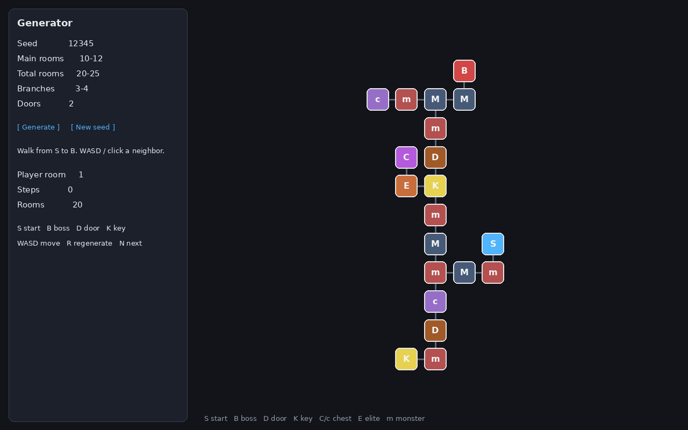
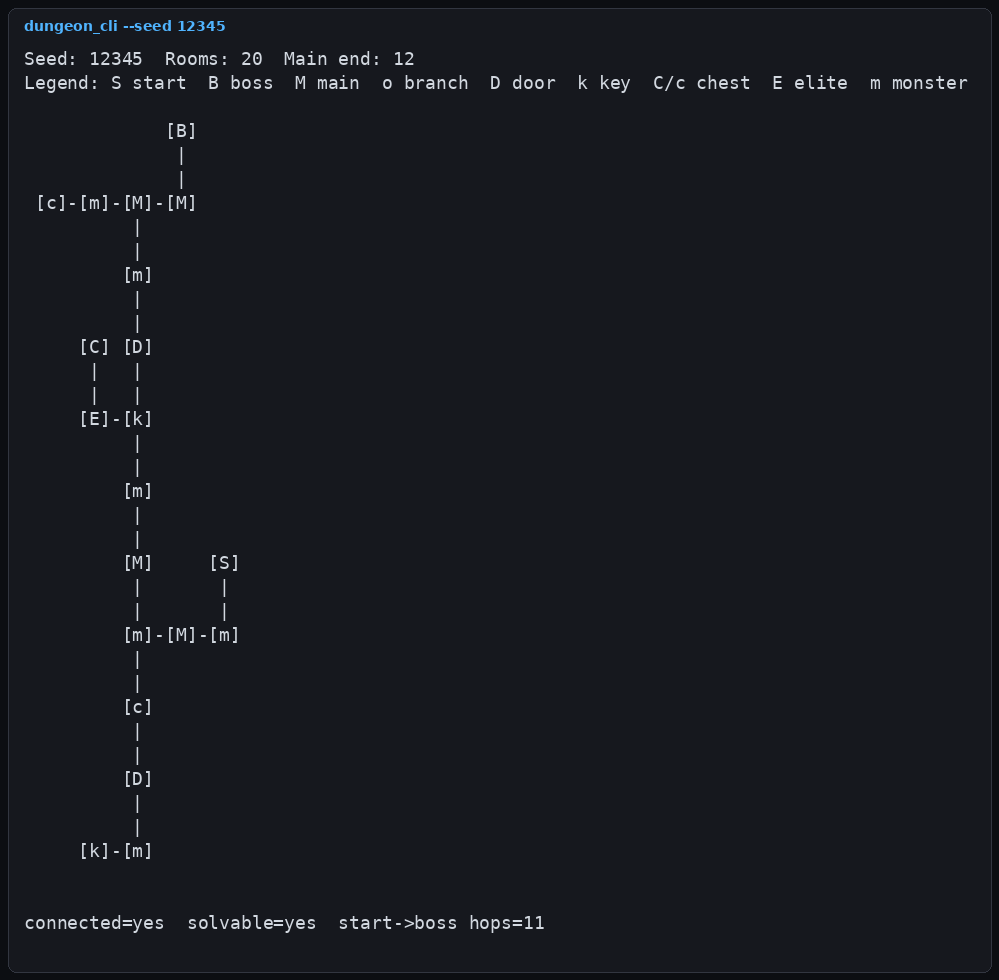
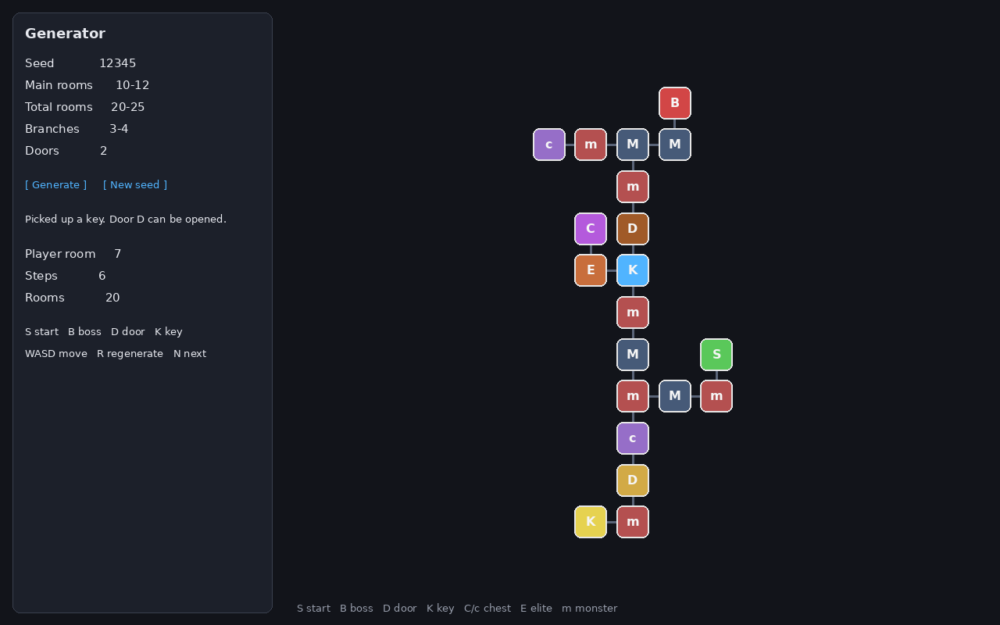
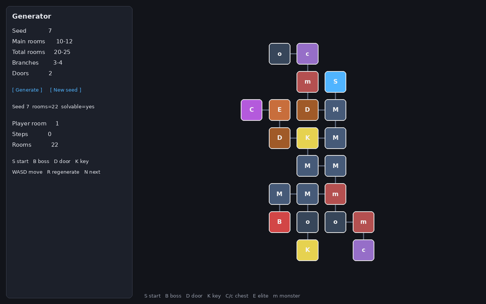

# dungeon-gen

[](https://github.com/nangongbee/dungeon-gen/actions/workflows/ci.yml)
[](LICENSE)

C++20 地牢生成。丢一个 seed 进去，吐出主线、支线、门和钥匙；同一个 seed 结果固定。

核心库 `dungeon_core` 只用标准库。想在图上走两步的话，另有一个 SDL2 + ImGui 的小窗口；没有 SDL 也能编过命令行和测试。



## 编译

只要核心、CLI 和测试（不拉 ImGui、不需要 SDL）：

```bash
cmake -S . -B build -DCMAKE_BUILD_TYPE=Release -DDUNGEON_BUILD_PLAY=OFF
cmake --build build -j
ctest --test-dir build --output-on-failure
```

要编可玩窗口时去掉 `-DDUNGEON_BUILD_PLAY=OFF`，并安装 `libsdl2-dev`。CMake 会用 FetchContent 下载 [Dear ImGui v1.91.8](https://github.com/ocornut/imgui)（首次配置会多花一点时间；仓库里不 vendoring `third_party/imgui`）。本机没有 SDL 时，配置阶段会跳过 `dungeon_play`，核心和测试照常编。

CMake 3.16+，C++20。

## 命令行

```bash
./build/dungeon_cli --seed 12345
./build/dungeon_cli --config config/default.json --seed 7
./build/dungeon_cli --seed 12345 --json
```

直接跟一个数字也行，当成 seed。ASCII 大概长这样：



## 走一下

```bash
./build/dungeon_play
```

左边改 seed / 房间数 / 支线 / 门，点 Generate。WASD 或点相邻房间移动，没钥匙进不了门，走到 Boss 过关。`R` 按当前参数再生成，`N` 是 seed + 1。

捡到钥匙后门会变色：



换 seed 拓扑差很多，比如 7：



本机没显示器时，截图是 `python3 scripts/render_screenshots.py` 按同一套生成结果画的。有窗口的话直接跑 `dungeon_play` 即可。

## 生成大致怎么走

主线用选择栈往前铺，走不通就退，顺带卡一下长宽比，避免拉成一条细长蛇。支线沿主线分段往外挂，某条挂失败就把房间数补给后面的支线。

支线接回主线时会查最短路：起点到 Boss 不能被抄得太近，默认不能短于主线房间数的 60%。门先放，钥匙必须落在「不经过这扇门也能走到」的区域，找不到合法位置就把这扇门拿掉，总比出死图好。

默认参数在 `config/default.json`。

```text
include/dungeon/   头文件
src/               生成、查询、Session
apps/cli           ASCII / JSON
apps/play          SDL2 + ImGui（可选）
tests/             连通、短路比、钥匙门、同 seed 复现
```

MIT，见 [LICENSE](LICENSE)。

GitHub: [nangongbee](https://github.com/nangongbee) · bumble.timwu@gmail.com
